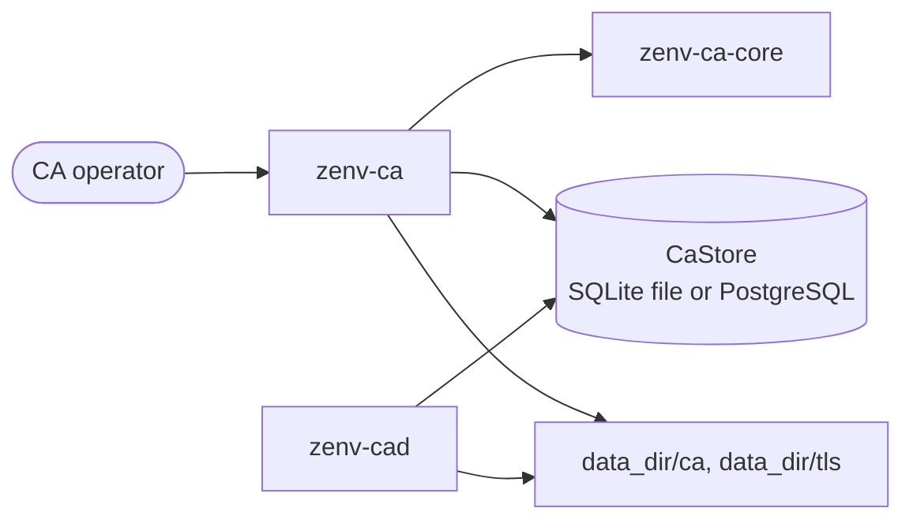

# zenv-ca-cli

`zenv-ca` is the **admin CLI** for the Zenv DMZ certificate authority. It does the work that should never be exposed over HTTP:

- bootstrapping the CA
- minting admin and requester tokens
- revoking from the shell
- re-issuing the daemon's TLS certificate
- checking the audit chain

It works **directly on the data directory and database**, using `zenv-ca-core`, the `CaStore` from `zenv-ca-store`, and the `Config` and backend selection (`storage`) from `zenv-ca-server`. It supports the same backends as the daemon, through the same features:

```bash
cargo build --release -p zenv-ca-cli                      # SQLite (default)
cargo build --release -p zenv-ca-cli --features postgres  # + PostgreSQL
``` Run it on the CA host as the service user. The running daemon sees changes, revocations included, without a restart.



## Global options

| Option | Default | |
|---|---|---|
| `-c, --config <PATH>` | `/etc/zenv-ca/zenv-ca.toml` | also read from `$ZENV_CA_CONFIG` |

Every change is audited with the actor `cli:$USER`.

## Commands

### `init`: bootstrap a new CA

```bash
zenv-ca init [--root-passphrase-file F] [--intermediate-passphrase-file F] [--admin-name admin]
```

1. Refuses to run if `data_dir` already holds a root certificate, or if the configured database already holds CA records (the SQLite file exists, or the PostgreSQL schema has audit entries).
2. Reads the root passphrase from the file, or prompts twice. Reads the intermediate passphrase from the file, the daemon's configured sources, or a prompt. Both must be at least 12 characters and must differ.
3. Creates `data_dir`, `ca/` and `tls/` with mode 0700.
4. Generates the root, then the intermediate with Name Constraints. Both keys are written encrypted, mode 0600.
5. Issues the daemon's TLS certificate for `ca.tls_hostnames`, or the `public_url` host. This step is skipped when `server.tls.enabled = false`.
6. Creates (migrates) the database and the first **admin token**, which is printed **once**. With PostgreSQL, run `init` with the **owner** role's config, then grant the app role. See [operations](../../docs/operations.md#postgresql-backend-optional).
7. Prints the root's SHA-256 fingerprint and the next steps. The most important one: **move `ca/root.key.enc` and the root passphrase offline.**

### `token`: API tokens

```bash
zenv-ca token create --name team-payments-ci [--role requester|admin]   # secret printed once
zenv-ca token list
zenv-ca token disable --name team-payments-ci                           # takes effect immediately
```

The token name is the identity. It is recorded as `requested_by` on certificates and as the actor in the audit log. Use one token per person or pipeline.

### `cert`: inventory and revocation

```bash
zenv-ca cert list [--status active|revoked|expired] [--owner NAME] [--search TEXT] [--json]
zenv-ca cert show <SERIAL> [--pem]
zenv-ca cert revoke <SERIAL> [--reason unspecified|key-compromise|affiliation-changed|superseded|cessation-of-operation]
zenv-ca cert expiring [--days 14]
```

Serials are accepted in any case, with or without `:` separators. Revocation is idempotent. The daemon re-signs the CRL on the next `/pki/crl.*` request.

### `tls issue`: renew the daemon's certificate

```bash
zenv-ca tls issue [--intermediate-passphrase-file F]
sudo systemctl restart zenv-cad
```

It issues a fresh `server` profile certificate for the daemon, valid for `policy.max_validity_days`. It replaces `tls/server.chain.pem` and `tls/server.key` atomically: each is written to a temporary file and then renamed.

### `audit`: tamper evidence

```bash
zenv-ca audit verify          # recompute the hash chain; non-zero exit if broken
zenv-ca audit tail [--limit 20]
```

`verify` prints the entry count and **head hash**. Record that hash outside the CA host, for example in a ticket or a chat channel, on a schedule. A later run that doesn't extend it shows the history was rewritten.

## Dev quick start

```bash
export ZENV_CA_CONFIG=config/zenv-ca.dev.toml
export ZENV_CA_INTERMEDIATE_PASSPHRASE_FILE=dev-data.intermediate.pass
printf 'dev-intermediate-pass' > dev-data.intermediate.pass
printf 'dev-root-passphrase!!' > dev-data.root.pass

cargo run --bin zenv-ca -- init --root-passphrase-file dev-data.root.pass
cargo run --bin zenv-ca -- token create --name alice
cargo run --bin zenv-ca -- cert list
```

## Design notes

- **File safety.** New secrets are written with `create_new` and an explicit mode, so they never overwrite anything and never rely on the umask. Replacements go through a temporary file and a rename.
- **Secrets.** Passphrases are read without echo (`rpassword`) and kept in `Zeroizing` buffers. A trailing newline in a passphrase file is ignored.
- **No daemon API.** The CLI never talks to `zenv-cad`. Both share the database: SQLite queues concurrent writers (`BEGIN IMMEDIATE` and a busy timeout), and PostgreSQL serialises them with an advisory lock. Either way, a CLI revocation shows up in the daemon's next CRL.

## See also

- [Operations](../../docs/operations.md): installation, the bootstrap ceremony, runbooks for key compromise, intermediate rotation and backups.
- [Use cases](../../docs/use-cases.md): UC-level descriptions of the admin flows.
