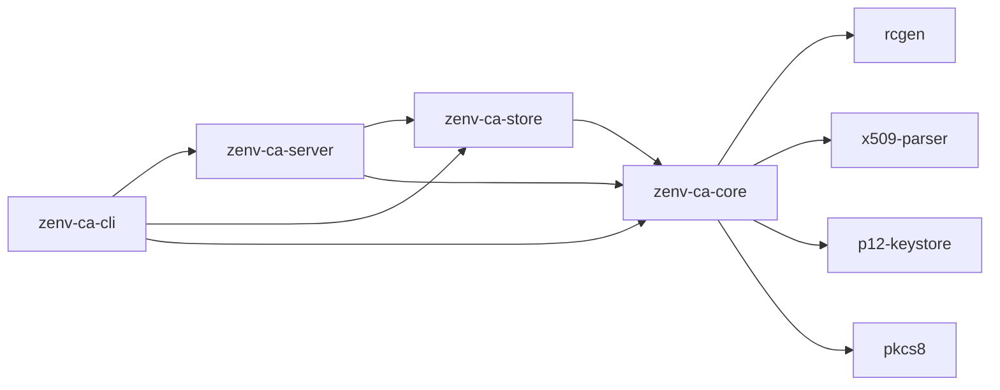

# zenv-ca-core

The **domain logic** of the Zenv DMZ certificate authority: CA hierarchy creation, issuance policy, certificate profiles, CSR and keygen issuance, CRL signing, verification and export formats.

The crate does **no I/O at all**: no files, no database, no network, no clock-driven background work. Callers hand it PEM strings and keys and get PEM/DER bytes and plain structs back. That keeps every security decision in one place where unit and integration tests can reach it.



## Modules

| Module | What it does |
|---|---|
| `hierarchy` | `create_root` and `create_intermediate`. The root is `pathLen=1`; the intermediate is `pathLen=0` with **critical Name Constraints** taken from the policy. |
| `authority` | `CertificateAuthority`: loads the root and intermediate, checks that key and chain match, then issues leaves (`issue_from_csr`, `issue_with_generated_key`) and signs CRLs (`build_crl`). |
| `policy` | `IssuancePolicy`: allowed DNS suffixes (label-boundary aware), IP networks, wildcard opt-in, max SANs, default and max validity. |
| `profile` | `CertProfile`: `server`, `client`, `server-client`. These fix key usage, extended key usage and basic constraints. Requesters cannot pick extensions. |
| `verify` | `CertificateAuthority::verify` returns a `VerificationReport` with one `Check` per step. |
| `revocation` | `RevocationReason`, `RevocationStatus`, and the `RevocationLookup` trait that a store implements. |
| `export` | `CertFormat` (PEM, DER, chain, full chain), `render_certificate`, `pkcs12_bundle`. |
| `keys` | `KeyAlgorithm` (P-256, P-384, RSA 2048/3072, Ed25519), plus encrypted PKCS#8 at rest (`encrypt_private_key`, `decrypt_private_key`). |
| `serial` | 128-bit random serials and canonical hex form. |
| `error` | `CaError` and `Result`. |

The most-used types are re-exported at the crate root (`zenv_ca_core::CertificateAuthority`, `IssuancePolicy`, `CertProfile`, …).

## Usage

### Build a hierarchy and issue from a CSR

```rust
use zenv_ca_core::hierarchy::{create_intermediate, create_root};
use zenv_ca_core::{
    CaSpec, CaSubject, CertProfile, CertificateAuthority, CsrRequest, IssuancePolicy, KeyAlgorithm,
};

let subject = |cn: &str| CaSubject {
    common_name: cn.into(),
    organization: "Zenv".into(),
    organizational_unit: "DMZ Non-Production".into(),
};
let policy = IssuancePolicy {
    allowed_dns_suffixes: vec!["dmz.zenv.internal".into()],
    ..IssuancePolicy::default()
};

// Offline step: the root key never touches the daemon host after this.
let root = create_root(&CaSpec {
    subject: subject("Zenv DMZ Root CA"),
    validity_days: 3650,
    key_algorithm: KeyAlgorithm::EcdsaP384,
})?;
let inter = create_intermediate(
    &root.cert_pem,
    &root.key,
    &CaSpec { subject: subject("Zenv DMZ Issuing CA"), validity_days: 1095, key_algorithm: KeyAlgorithm::EcdsaP384 },
    &policy,
)?;

// Online: the daemon loads only the intermediate key.
let ca = CertificateAuthority::load(
    &root.cert_pem,
    &inter.cert_pem,
    inter.key,
    policy,
    Some("https://ca.dmz.zenv.internal/pki/crl.der".into()),
)?;

let issued = ca.issue_from_csr(&CsrRequest {
    csr_pem: std::fs::read_to_string("app.csr")?,
    profile: CertProfile::Server,
    validity_days: Some(30),
})?;
println!("{} {} until {}", issued.serial, issued.common_name, issued.not_after);
```

Only the CSR's **public key and names** are used. Every other field comes from the profile. A CSR whose CN isn't one of its SANs has that CN dropped, and a legacy CSR with no SANs gets its CN copied in as a SAN. Any name outside the policy is rejected with `CaError::Policy`.

### Server-side keygen and PKCS#12

```rust
use zenv_ca_core::export::pkcs12_bundle;
use zenv_ca_core::{KeyAlgorithm, KeygenRequest};

let (issued, key) = ca.issue_with_generated_key(&KeygenRequest {
    common_name: Some("api.dmz.zenv.internal".into()),
    dns_names: vec!["api.dmz.zenv.internal".into()],
    ip_addresses: vec![],
    profile: Default::default(),
    validity_days: None,                 // policy default (30 days)
    key_algorithm: KeyAlgorithm::EcdsaP256,
})?;
let p12 = pkcs12_bundle(&issued.cert_pem, &key, &ca, "api", "a-strong-password")?;
```

The PKCS#12 uses AES-256-CBC with an HMAC-SHA256 MAC, and OpenSSL 3, Java `keytool` and .NET can all read it. Server-side keygen can be switched off with `allow_server_side_keygen = false`.

### Verify a certificate

```rust
use zenv_ca_core::{NoRevocationInfo, VerifyOptions};

let report = ca.verify(
    issued.cert_pem.as_bytes(),          // PEM or DER
    &VerifyOptions { hostname: Some("app.dmz.zenv.internal".into()), at: None },
    &NoRevocationInfo,                   // or a `zenv_ca_store::Store`
);
for check in &report.checks {
    println!("{:<18} {} {}", check.name, if check.passed { "ok" } else { "FAIL" }, check.detail);
}
assert!(!report.valid); // NoRevocationInfo answers Unknown, and Unknown fails closed
```

The checks run in this order: `parse`, `signature`, `chain`, `validity`, `basic-constraints`, `name-constraints`, `revocation`, and `hostname` when one was asked for. An `Unknown` revocation status **fails** the report.

### Sign a CRL

```rust
use time::Duration;
let crl = ca.build_crl(&revoked_entries, crl_number, Duration::hours(168))?;
std::fs::write("crl.der", &crl.der)?;
```

The caller supplies the revoked entries and a monotonically increasing CRL number. In the daemon both come from the store.

## Design notes

- **Crypto backend.** It's aws-lc-rs everywhere: rcgen signs, and x509-parser's `verify-aws` checks signatures. There is no OpenSSL dependency.
- **CA keys at rest** are encrypted PKCS#8: PBES2 with PBKDF2-HMAC-SHA256 (600 000 iterations) and AES-256-CBC. `openssl pkey` can decrypt them, which matters for offline-root ceremonies. Passphrases must be at least 12 characters.
- **Leaf defaults.**
  - Serial: 128-bit random.
  - `notBefore`: backdated 5 minutes for clock skew.
  - Extensions: AKI, plus a CRL Distribution Point when a CRL URL is configured.
  - Lifetime: capped at `max_validity_days`, which defaults to 90.
- **Secrets.** Private keys come back as `Zeroizing<String>`. `GeneratedCa`'s `Debug` output redacts the key.

## Tests

```bash
cargo test -p zenv-ca-core
```

Unit tests sit next to each module. [`tests/lifecycle.rs`](tests/lifecycle.rs) covers the whole lifecycle: building the hierarchy, CSR and keygen issuance, policy rejections, tampered CSRs, expiry, foreign and revoked certificates, CRL contents, export formats, and a PKCS#12 round trip.

## See also

- [Architecture](../../docs/architecture.md) covers the PKI hierarchy and data model.
- [Security](../../docs/security.md) covers crypto choices and the threat model.
- ADRs: [Rust](../../docs/adr/0001-rust.md), [two-tier hierarchy with Name Constraints](../../docs/adr/0002-two-tier-hierarchy-with-name-constraints.md), [CSR-first issuance](../../docs/adr/0003-csr-first-issuance.md).
