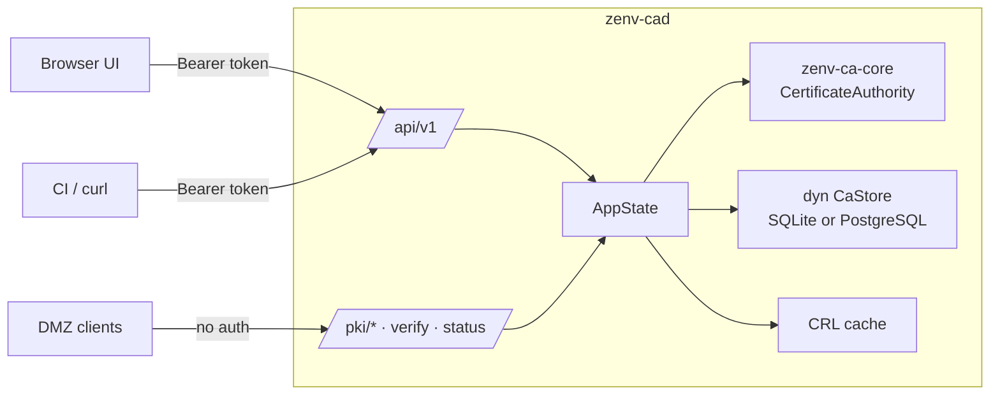

# zenv-ca-server

The **Zenv DMZ CA daemon**, `zenv-cad`. It serves:

- the REST API for issuance, download, revocation and verification
- the embedded self-service **web UI**
- the **trust anchors and CRL** that DMZ clients fetch
- health and readiness probes

It's built on axum 0.8 and tokio, with optional TLS through rustls. The crate is also a library (`zenv_ca_server`), so the CLI can reuse its `Config` and the integration tests can drive the router in-process.



## Running

```bash
# development: plain HTTP on 127.0.0.1:8080, state in ./dev-data
ZENV_CA_CONFIG=config/zenv-ca.dev.toml \
ZENV_CA_INTERMEDIATE_PASSPHRASE_FILE=dev-data.intermediate.pass \
cargo run --bin zenv-cad
```

### Storage backends (Cargo features)

| Feature | Default | Backend crate | Config |
|---|---|---|---|
| `sqlite` | yes | [`zenv-ca-store-sqlite`](../zenv-ca-store-sqlite/README.md) | `[database] backend = "sqlite"` (or no `[database]` at all) |
| `postgres` | no | [`zenv-ca-store-postgres`](../zenv-ca-store-postgres/README.md) | `[database] backend = "postgres"`, `url`, … |

```bash
cargo build --release -p zenv-ca-server --features postgres          # both backends
cargo build --release -p zenv-ca-server --no-default-features --features postgres
```

[`src/storage.rs`](src/storage.rs) is the only module that names a backend crate. It turns `[database]` into an `Arc<dyn CaStore>`. If a config asks for a backend that wasn't compiled in, start-up fails with a rebuild hint.

The CA must already exist; create it with [`zenv-ca init`](../zenv-ca-cli/README.md). In production run it under the hardened systemd unit [`deploy/zenv-cad.service`](../../deploy/zenv-cad.service). See [operations](../../docs/operations.md).

At start-up the daemon:

1. Loads the config from `--config`, `$ZENV_CA_CONFIG` or `/etc/zenv-ca/zenv-ca.toml`. Unknown keys are rejected.
2. Finds the intermediate key passphrase. It **never prompts**; if no source is found it exits.
3. Decrypts the intermediate key, then checks that the key matches the certificate and that the chain leads to the root.
4. Opens the store and signs an initial CRL on a blocking thread: connecting, migrating and the first CRL all touch the database. The PostgreSQL backend reports a wrong password or TLS failure here, immediately.
5. Starts the expiry monitor (every 12 h it logs a warning for certificates expiring within 14 days), then serves HTTP or HTTPS.
6. On SIGINT or SIGTERM it stops accepting connections and drains for up to 10 s.

### Passphrase lookup order

| # | Source | Notes |
|---|---|---|
| 1 | `$ZENV_CA_INTERMEDIATE_PASSPHRASE_FILE` | path to a file |
| 2 | `ca.intermediate_passphrase_file` in the config | path to a file |
| 3 | `$CREDENTIALS_DIRECTORY/intermediate-passphrase` | systemd `LoadCredential=`, **recommended** |
| 4 | `$ZENV_CA_INTERMEDIATE_PASSPHRASE` | development only; logs a warning |

Trailing newlines are stripped and the passphrase is zeroized after use.

The PostgreSQL password follows the same pattern: `$ZENV_CA_DATABASE_PASSWORD_FILE`, then `database.password_file`, then `$CREDENTIALS_DIRECTORY/database-password`, then `$ZENV_CA_DATABASE_PASSWORD` (dev only).

## Configuration

See [`config/zenv-ca.example.toml`](../../config/zenv-ca.example.toml) for a commented, production-like file. The sections:

| Section | Keys |
|---|---|
| `[server]` | `listen`, `public_url` (used in the CRL Distribution Point and UI links), `max_body_bytes` (64 KiB), `request_timeout_secs` |
| `[server.tls]` | `enabled`, `cert`, `key` (default to `<data_dir>/tls/`) |
| `[paths]` | `data_dir` (default `/var/lib/zenv-ca`, mode 0700) |
| `[ca.root]`, `[ca.intermediate]` | `subject.{common_name, organization, organizational_unit}`, `validity_days`, `key_algorithm` |
| `[ca]` | `intermediate_passphrase_file`, `tls_hostnames` |
| `[policy]` | `allowed_dns_suffixes`, `allowed_ip_networks`, `default_validity_days`, `max_validity_days`, `allow_wildcards`, `allow_server_side_keygen`, `max_sans` |
| `[crl]` | `validity_hours` (168). The CRL is re-signed at half-life or right after any revocation. |
| `[logging]` | `format` (`pretty` / `json`), `filter` (`RUST_LOG` overrides it) |
| `[database]` | `backend` (`sqlite` default / `postgres`). SQLite: `path`. PostgreSQL: `url`, `password_file`, `schema`, `pool_size` (8), `connect_timeout_secs` (10), `tls_ca_file`. Unknown or wrong-backend keys are rejected. |

Data directory layout:

```
<data_dir>/
  ca/root.crt  ca/root.key.enc   ← move root.key.enc offline after init
  ca/intermediate.crt  ca/intermediate.key.enc
  tls/server.chain.pem  tls/server.key
  zenv-ca.db (+ -wal, -shm)          ← SQLite backend only
```

## HTTP surface

| Method & path | Auth | Purpose |
|---|---|---|
| `GET /` , `/ui/app.js`, `/ui/style.css` | none | self-service UI |
| `GET /healthz`, `/readyz` | none | liveness; readiness (database ping, e.g. `{"status":"ready","database":"postgres"}`) |
| `GET /pki/root.crt`, `/pki/root.der` | none | trust anchor |
| `GET /pki/intermediate.crt`, `/pki/chain.pem` | none | issuing CA, and intermediate + root |
| `GET /pki/crl.der`, `/pki/crl.pem` | none | current CRL (the URL embedded in every leaf) |
| `GET /api/v1/ca` | none | CA metadata and policy summary |
| `POST /api/v1/verify` | none | full verification report for a PEM/DER certificate |
| `GET /api/v1/certificates/{serial}/status` | none | `good` / `revoked` / `unknown` |
| `GET /api/v1/me` | token | who am I |
| `POST /api/v1/certificates` | token | issue from a CSR |
| `POST /api/v1/certificates/keygen` | token | issue with a server-generated key; returns PEM key + base64 PKCS#12 **once** |
| `GET /api/v1/certificates` | token | list (own; admins see all and can filter by `requested_by`) |
| `GET /api/v1/certificates/{serial}` | token | details (owner or admin) |
| `GET /api/v1/certificates/{serial}/download?format=pem\|der\|chain\|fullchain` | token | download (owner or admin) |
| `POST /api/v1/certificates/{serial}/revoke` | token | revoke (owner or admin) |
| `GET /api/v1/audit`, `/api/v1/audit/verify` | admin | audit tail; recompute the hash chain |

The full reference, with request and response bodies and curl examples, is in [docs/api.md](../../docs/api.md).

## Source layout

| Path | What it does |
|---|---|
| `src/main.rs` | the `zenv-cad` binary: CLI flags, tracing, TLS, signals, expiry monitor |
| `src/lib.rs` | `load_authority(config, passphrase)` |
| `src/config.rs` | `Config` (serde, `deny_unknown_fields`), path helpers, `passphrase_from_environment` |
| `src/state.rs` | `AppState`: CA, `Arc<dyn CaStore>`, CRL cache, and `blocking()`, which runs **all** store and crypto work on `spawn_blocking` |
| `src/storage.rs` | backend selection: `open_store`, `is_provisioned`, `describe` (credential-free location for logs) |
| `src/auth.rs` | `Auth` and `AdminAuth` extractors (Bearer token → `Principal`) |
| `src/error.rs` | `ApiError`, which renders **RFC 9457 problem+json** and logs internal details instead of returning them |
| `src/routes/` | `pki`, `certs`, `verify`, `admin`, `ui`, and the router with limits and security headers in `mod.rs` |
| `ui/` | vanilla HTML/JS/CSS, compiled in with `include_str!`; no build step, no CDN |

## Design notes

- **Security headers on every response:**
  - strict CSP with `default-src 'none'` and only same-origin scripts and styles
  - `X-Content-Type-Options: nosniff`, `X-Frame-Options: DENY`, `Referrer-Policy: no-referrer`, COOP
  - HSTS when TLS is enabled
  - `Cache-Control: no-store` on the API
- **Ownership.** Asking for someone else's certificate returns **404**, not 403, so serials can't be probed.
- **Limits.** Body size limit and request timeout; requests that exceed them get 413 and 408.
- **Non-blocking runtime.** Store calls, RSA keygen and signing never run on the async executor. The sync PostgreSQL client would panic if they did.
- **Store conflicts.** A unique violation (`StoreError::Conflict`) returns `409`; every other store error is a logged `500`.
- **CRL cache.** The signed CRL is cached together with the store's revocation revision. A revocation from either the API or the CLI changes that revision, so the next `/pki/crl.*` request re-signs.
- **UI.** It renders everything with `textContent`, never `innerHTML`. The token lives in `sessionStorage`, so closing the tab signs out.

## Tests

```bash
cargo test -p zenv-ca-server
```

[`tests/api.rs`](tests/api.rs) drives the real router in-process with `tower::ServiceExt::oneshot` against a temporary CA. It covers:

- public endpoints and security headers
- authentication being required
- the full CSR → download → verify → revoke → CRL flow (on an in-memory SQLite store; backend behaviour itself is covered by the store conformance suites)
- keygen and policy errors
- oversized bodies

Unit tests in `config.rs` parse the shipped example config and check `[database]` selection, including that typos and wrong-backend keys are rejected. `storage.rs` checks that logged locations never contain credentials.

## See also

- [API reference](../../docs/api.md)
- [Flows](../../docs/flows.md), with sequence diagrams for issuance, TLS validation, verify and revocation
- [Operations](../../docs/operations.md) and [Security](../../docs/security.md)
