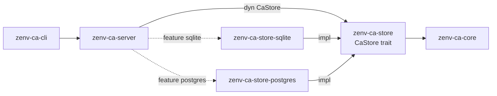

# zenv-ca-store

The **storage contract** of the Zenv DMZ certificate authority. It defines the [`CaStore`](src/lib.rs) trait, the record types, and the logic that every database backend must share. It has **no database dependency**. Concrete backends live in their own crates:

| Crate | Backend | When |
|---|---|---|
| [`zenv-ca-store-sqlite`](../zenv-ca-store-sqlite/README.md) | embedded SQLite file | default; one CA host |
| [`zenv-ca-store-postgres`](../zenv-ca-store-postgres/README.md) | PostgreSQL | several daemon instances (HA), or a managed database |



The daemon and the CLI only ever hold an `Arc<dyn CaStore>`. The single place that picks a backend is `zenv-ca-server/src/storage.rs`, driven by Cargo features and the `[database] backend` config key.

## What lives here, and why

Anything where backends could disagree in a way that matters lives in this crate:

| Module | Shared logic |
|---|---|
| `lib` | `CaStore` trait (object-safe, blocking); `Revocations`, a **fail-closed** `RevocationLookup` adapter where a DB error means `Unknown`, never `Good`; `now_unix` |
| `audit` | `AuditRow::next` builds the next hash-chained entry; `ChainVerifier` streams rows and finds the first break; `events` holds canonical action names and `details` payloads |
| `tokens` | `NewToken::generate` (`zca_` + 32 random bytes), `hash_token` (SHA-256), `is_well_formed`, `Role`, `Principal`, `TokenInfo` |
| `certs` | `CertificateRow`, the stored column format (encode/decode), `CERT_COLUMNS`, `CertStatus::derive`, `CertFilter` (`effective_limit`, escaped `search_pattern`), revocation and CRL decoders |
| `error` | `StoreError`: `Backend`, `Conflict` (unique violation), `Io`, `Corrupt`, `SchemaTooNew`, `Configuration` |
| `testkit` | (feature `testkit`) the backend conformance suite |

Because the hash chain is computed here, an audit log written by one backend verifies byte-for-byte on another after a migration.

## Using a store

```rust
use std::sync::Arc;
use zenv_ca_store::{CaStore, CertFilter, CertStatus, IssuanceMethod, Revocations, RevokeOutcome, Role};

fn example(store: Arc<dyn CaStore>, issued: &zenv_ca_core::IssuedCertificate, ca: &zenv_ca_core::CertificateAuthority)
    -> zenv_ca_store::StoreResult<()>
{
    // Tokens: the secret is returned once; only its SHA-256 hash is stored.
    let (_info, secret) = store.create_token("team-payments-ci", Role::Requester, "cli:alice")?;
    let principal = store.authenticate(&secret)?.expect("valid token");

    // The certificate and its audit entry are written in one transaction.
    store.insert_certificate(issued, IssuanceMethod::Csr, &principal.name)?;

    let mine = store.list_certificates(&CertFilter {
        requested_by: Some(principal.name.clone()),
        status: Some(CertStatus::Active),
        ..CertFilter::default()
    })?;

    // Revoking is idempotent.
    if let RevokeOutcome::NotFound = store.revoke(&issued.serial, zenv_ca_core::RevocationReason::Superseded, "admin")? {
        eprintln!("unknown serial");
    }

    // Verification with live revocation data, failing closed on DB errors.
    let report = ca.verify(issued.cert_pem.as_bytes(), &Default::default(), &Revocations(&*store));

    let chain = store.verify_audit_chain()?;
    assert!(chain.intact, "audit chain broken at {:?}", chain.first_broken_id);
    println!("{} active, valid: {}", mine.len(), report.valid);
    Ok(())
}
```

All methods **block**. In async code call them from `spawn_blocking`, as the daemon's `AppState::blocking` does.

## Writing a new backend

1. Create a crate `zenv-ca-store-<name>` that depends on `zenv-ca-store`, and implement `CaStore`.
2. Follow the contract:
   - Each mutation writes its audit row **in the same transaction**, built with `AuditRow::next(last, …)` while holding a lock that serialises appenders.
   - Store `details` and the other JSON columns as **exact text**.
   - Map unique violations to `StoreError::Conflict`.
   - Use the shared helpers (`CertificateRow`, `NewToken`, `hash_token`, `events`, `ChainVerifier`) rather than reimplementing them.
3. Run the conformance suite:

   ```toml
   [dev-dependencies]
   zenv-ca-store = { workspace = true, features = ["testkit"] }
   ```

   ```rust
   // tests/conformance.rs
   fn fresh() -> Option<Box<dyn zenv_ca_store::CaStore>> {
       Some(Box::new(MyStore::open_empty().unwrap()))   // None = skip (e.g. no server)
   }
   zenv_ca_store::conformance_tests!(fresh);

   #[test]
   fn two_handles() {
       zenv_ca_store::testkit::concurrent_writers_keep_chain_intact(handle_a(), handle_b());
   }
   ```

4. In `zenv-ca-server`, add an optional dependency, a feature, a `DatabaseConfig` variant and one match arm in `storage.rs`. Forward the feature from `zenv-ca-cli`.

## Conformance suite

`conformance_tests!` generates one `#[test]` per case, each on a fresh store:

| Case | Checks |
|---|---|
| `tokens_authenticate_and_disable` | hashing, prefix, `last_used_at`, disable, malformed and oversized tokens |
| `duplicate_token_names_conflict` | `Conflict`, and no orphan audit row |
| `inventory_filters_and_pagination` | owner, status, search, limit/offset, `expiring_within` ordering |
| `revocation_and_crl_entries` | idempotent revoke, revision counter, expired certs left off the CRL |
| `duplicate_serials_conflict_without_audit` | serial and fingerprint uniqueness; the failed insert rolls back its audit row |
| `audit_chain_covers_every_change` | every mutation audited, newest-first log, links, head hash |
| `crl_numbers_are_monotonic` | 1, 2, 3, … |
| `revocation_lookup_fails_closed` | `Unknown` for foreign serials |
| `search_treats_wildcards_literally` | `%` and `_` escaped |

`concurrent_writers_keep_chain_intact` runs 4 threads over 2 handles, issuing, revoking and allocating CRL numbers. It requires every write to land and the audit chain to be one unbroken line.

## Tests

```bash
cargo test -p zenv-ca-store          # unit tests of the shared logic
cargo test -p zenv-ca-store-sqlite   # conformance suite on SQLite
```

## See also

- [ADR 0006: pluggable storage backends](../../docs/adr/0006-pluggable-storage-backends.md)
- [ADR 0004: hash-chained audit log](../../docs/adr/0004-sqlite-and-hash-chained-audit.md)
