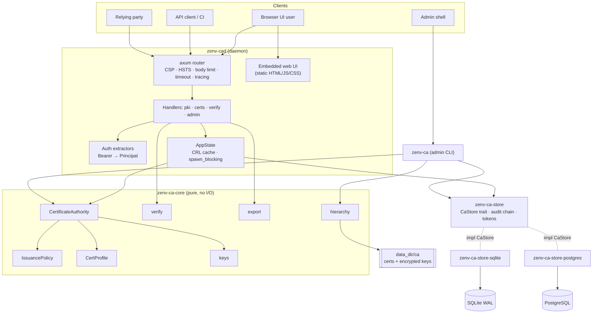
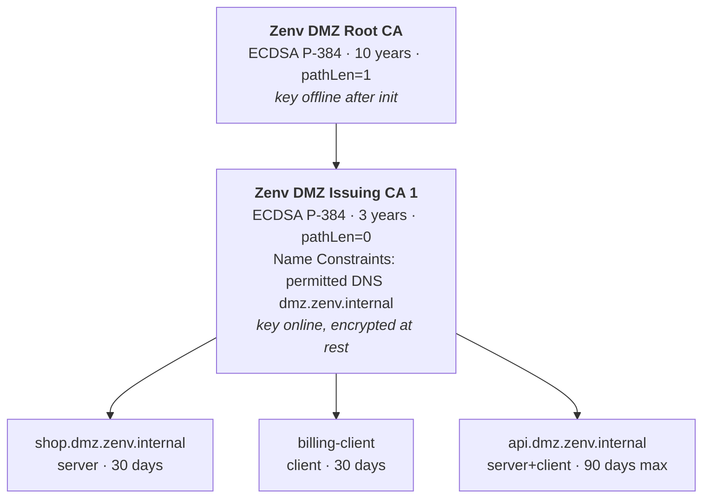
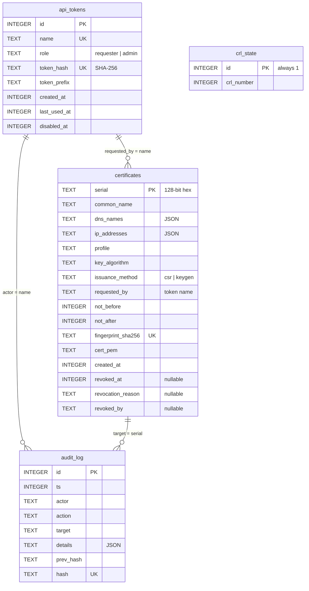
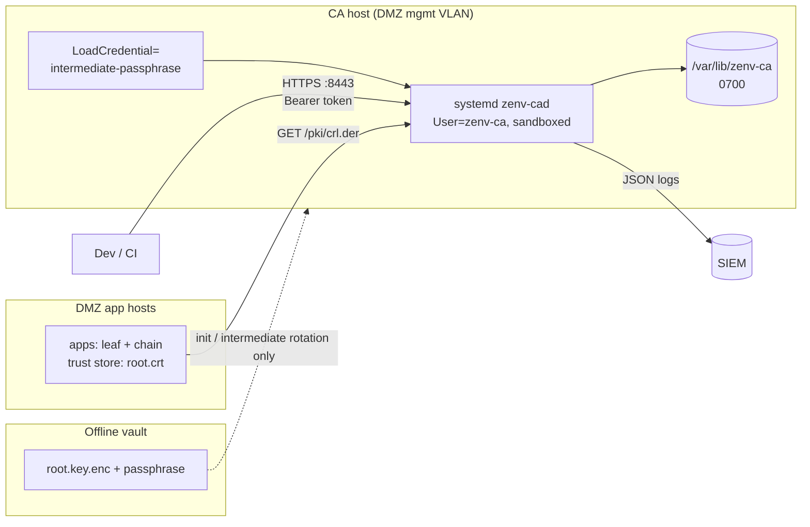

# Architecture

## 1. Context and goals

Zenv runs applications in a **DMZ / pre-production zone** before they reach production. Those apps need TLS certificates that are:

- **trusted inside the DMZ** (one root installed in DMZ trust stores),
- **self-service** (teams don't file tickets for certificates),
- **constrained** (cannot be abused for names outside the DMZ namespace),
- **revocable and verifiable**,
- **never trusted in production** (separate hierarchy, marked `OU=DMZ Non-Production`).

Non-goals: being a public CA, issuing code-signing or S/MIME certificates, or replacing the production PKI.

## 2. The "validator" role, precisely

A CA does not sit on every TLS connection. Relying parties validate certificates **locally** against the root they trust. The CA's part in validation is:

| Mechanism | Who uses it | Endpoint |
|---|---|---|
| Trust anchor distribution | every client | `/pki/root.crt`, `/pki/chain.pem` |
| **CRL** (standard, offline-friendly) | TLS stacks, OpenSSL, Java, Go | `/pki/crl.der` (embedded in every cert) |
| **Status API** (live, JSON) | apps wanting an explicit check | `/api/v1/certificates/{serial}/status` |
| **Verify API** (full report) | humans, debugging, admission checks | `/api/v1/verify` |

See [flows.md › Runtime TLS validation](flows.md#runtime-tls-validation).

## 3. Components

Each crate name links to its README (modules, usage examples, design notes).

| Crate | Responsibility | Depends on |
|---|---|---|
| [`zenv-ca-core`](../crates/zenv-ca-core/README.md) | Hierarchy bootstrap, policy, profiles, issuance, CRL building, verification, export formats, key encryption. **No I/O**, fully unit-testable. | rcgen, x509-parser, p12-keystore, pkcs8 |
| [`zenv-ca-store`](../crates/zenv-ca-store/README.md) | Storage **contract**: the object-safe `CaStore` trait, record types, and the logic every backend must share: audit hash chain, token hashing, row encoding, fail-closed `Revocations`, plus a conformance test kit. No database dependency. | core |
| [`zenv-ca-store-sqlite`](../crates/zenv-ca-store-sqlite/README.md) | `SqliteStore`: embedded file, WAL, `BEGIN IMMEDIATE` writes. Default backend. | store, rusqlite |
| [`zenv-ca-store-postgres`](../crates/zenv-ca-store-postgres/README.md) | `PostgresStore`: r2d2 pool, rustls TLS, advisory-locked audit appends for multi-instance deployments. | store, postgres, rustls |
| [`zenv-ca-server`](../crates/zenv-ca-server/README.md) | `zenv-cad` binary + library: config, auth, routes, UI, TLS, graceful shutdown, and `storage::open_store`, which picks the backend. | core, store, backends (Cargo features), axum, axum-server (rustls) |
| [`zenv-ca-cli`](../crates/zenv-ca-cli/README.md) | `zenv-ca` binary: `init`, `token`, `cert`, `tls`, `audit`. | core, store, server (config + storage) |

Dependencies point one way: `cli → server → store-{sqlite,postgres} → store → core`. Core knows nothing about HTTP or SQL. Handlers and the CLI see only `Arc<dyn CaStore>`. The backend crates are referenced in a single module (`zenv-ca-server/src/storage.rs`), behind Cargo features `sqlite` (default) and `postgres`, and chosen at runtime by `[database] backend`. See [ADR 0006](adr/0006-pluggable-storage-backends.md).

## 4. PKI hierarchy

Leaf certificate contents (fixed by profile, never by the CSR):

| Field | Value |
|---|---|
| Serial | 128-bit CSPRNG, positive |
| Subject | `CN=<first SAN>` (CA-controlled) |
| SAN | validated DNS names / IPs |
| Basic Constraints | `CA:FALSE` (critical) |
| Key Usage | `digitalSignature` (+ `keyEncipherment` for RSA) |
| Extended Key Usage | `serverAuth` / `clientAuth` / both |
| AKI / SKI | present |
| CRL Distribution Point | `<public_url>/pki/crl.der` |
| Validity | `notBefore = now − 5 min`, default 30 d, max 90 d |

## 5. Data model

`audit_log` has `BEFORE UPDATE` / `BEFORE DELETE` triggers that abort, and each row's `hash = SHA-256(prev_hash ‖ id ‖ ts ‖ actor ‖ action ‖ target ‖ details)`.

## 6. Runtime model

- **tokio** multi-threaded runtime. All signing, key generation (RSA can take 100+ ms) and every store call run in `spawn_blocking`, so the async executor never stalls. Store backends are synchronous by design; the PostgreSQL client must not run on an async worker thread.
- **SQLite**: one connection per process behind a mutex (SQLite serialises writers anyway, and operations take µs). WAL mode, `synchronous=FULL`, `busy_timeout=5s`. Writes use `BEGIN IMMEDIATE`, so daemon and CLI writes queue rather than fail.
- **PostgreSQL**: an r2d2 pool (`pool_size`, default 8). Each write transaction first takes `pg_advisory_xact_lock(class, hashtext(schema))`, which serialises audit appends across **all** daemon instances so the hash chain never forks. CRL numbers come from a single-row `UPDATE … RETURNING`, so they stay monotonic across instances.
- **CRL cache**: re-signed when half its validity has passed **or** the revocation revision (`count, max(revoked_at)`) changes, which also catches CLI revocations.
- **Graceful shutdown** on SIGTERM/SIGINT with a 10 s drain.
- **Expiry monitor**: every 12 h, logs a warning for each active cert expiring within 14 days.

## 7. Deployment

See [operations.md](operations.md) for the systemd unit, backups and runbooks.

## 8. Key decisions

| ADR | Decision |
|---|---|
| [0001](adr/0001-rust.md) | Rust, with rcgen/x509-parser/rustls on aws-lc-rs: memory safety for key-holding software |
| [0002](adr/0002-two-tier-hierarchy-with-name-constraints.md) | Two-tier hierarchy; intermediate carries Name Constraints |
| [0003](adr/0003-csr-first-issuance.md) | CSR-first issuance; keygen as an opt-out convenience that keeps no keys |
| [0004](adr/0004-sqlite-and-hash-chained-audit.md) | SQLite + hash-chained append-only audit log |
| [0005](adr/0005-crl-and-status-api-before-ocsp.md) | CRL + JSON status API now; OCSP and ACME on the roadmap |
| [0006](adr/0006-pluggable-storage-backends.md) | Storage behind a `CaStore` trait; SQLite and PostgreSQL as separate crates selected by feature + config |
