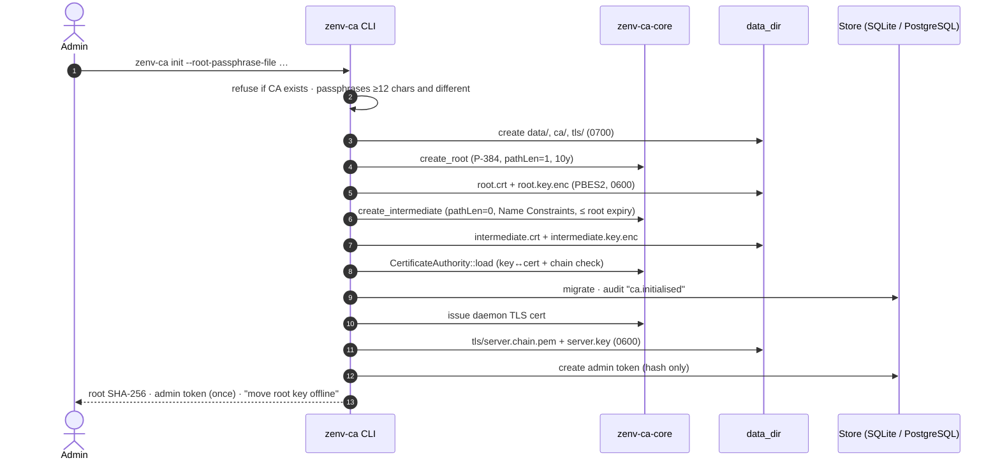
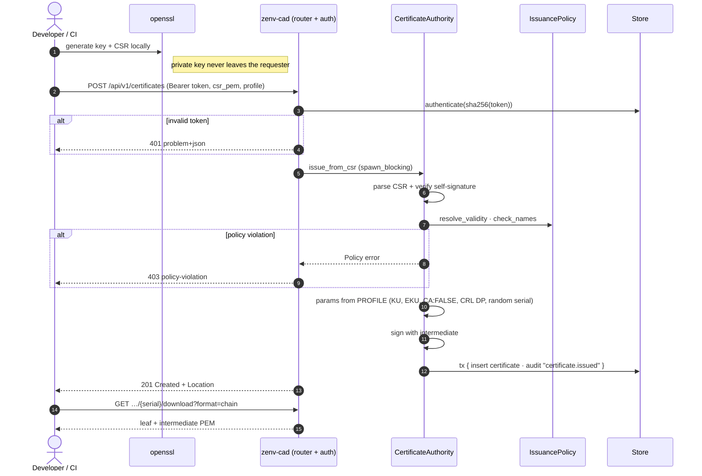
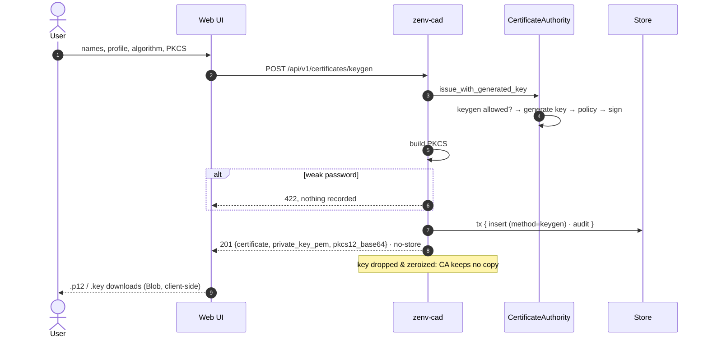
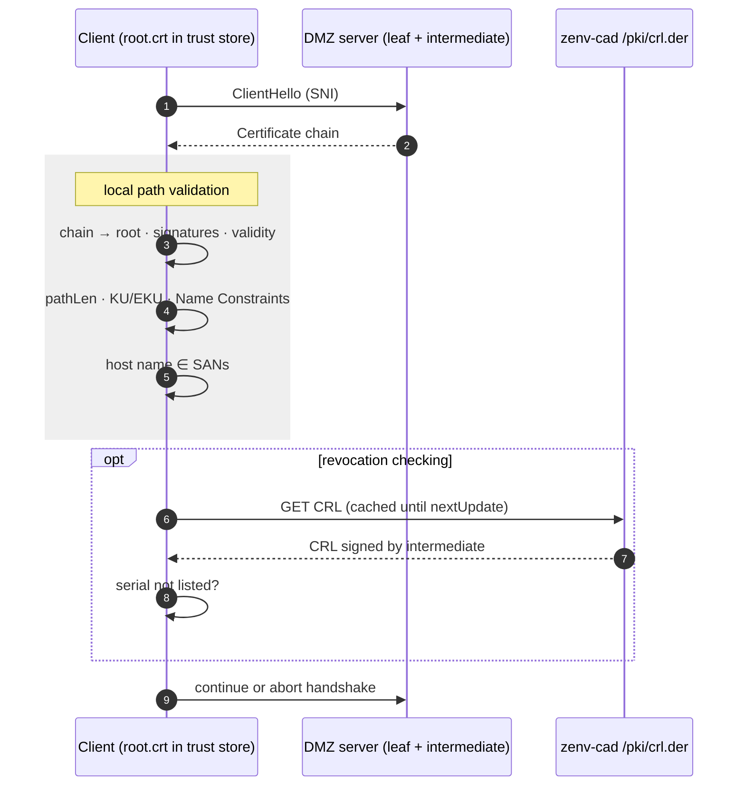
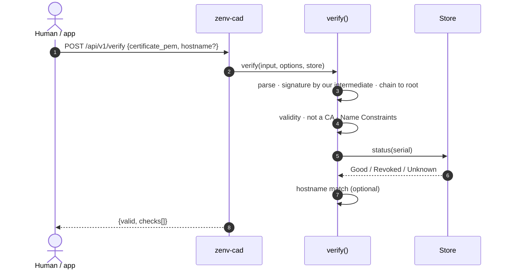
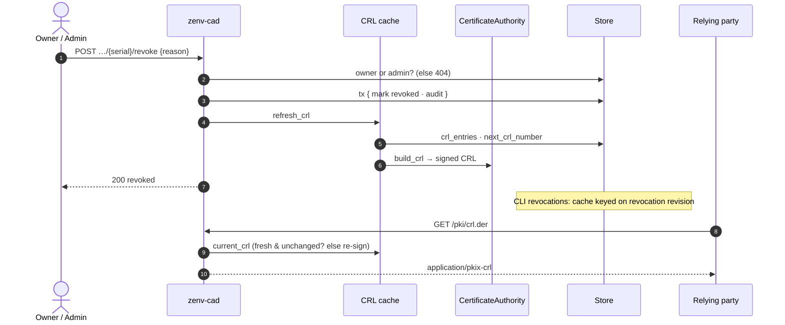
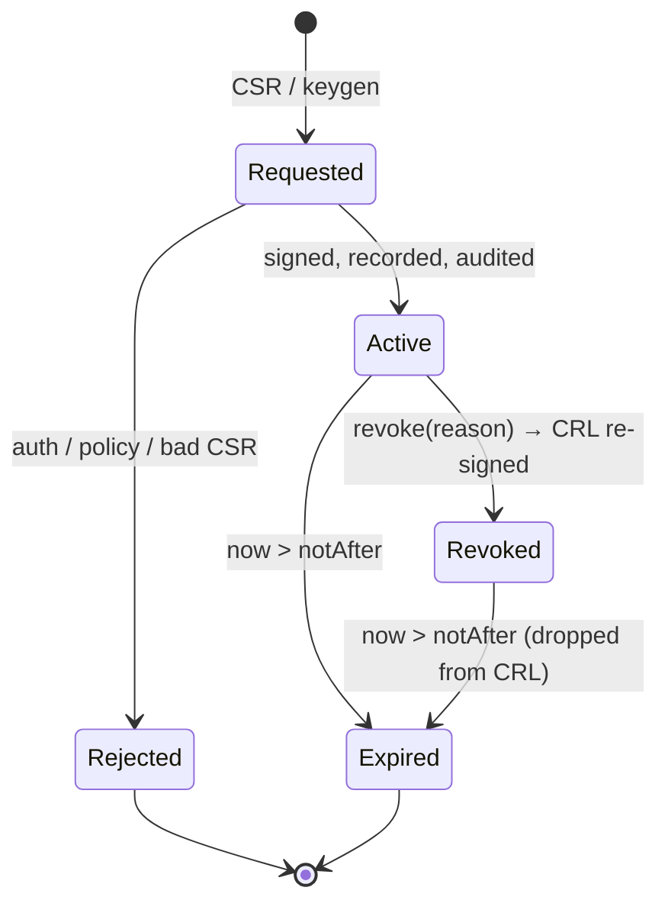

# Flows (sequence & state diagrams)

PlantUML sources with more detail live in [`uml/`](uml/). The Mermaid diagrams below render on GitHub.

- [Bootstrap](#uc10-bootstrap)
- [Issue from CSR](#uc1-issue-from-csr)
- [Server-side keygen](#uc2-server-side-keygen)
- [Runtime TLS validation by a relying party](#runtime-tls-validation)
- [Explicit verification](#uc6-explicit-verification)
- [Revocation & CRL](#uc5-revocation--crl-publication)
- [Certificate lifecycle](#certificate-lifecycle)

## UC10: Bootstrap

## UC1: Issue from CSR

## UC2: Server-side keygen

## Runtime TLS validation

How certificates are actually validated in the DMZ. **The CA is not on the hot path**: clients validate locally and only fetch the CRL.

## UC6: Explicit verification

## UC5: Revocation & CRL publication

## Certificate lifecycle

