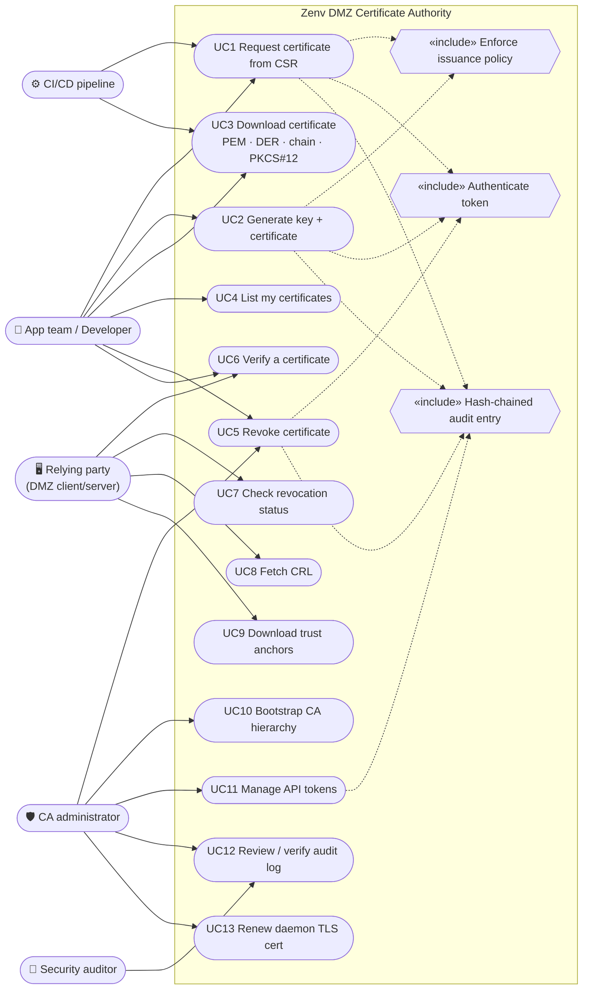

# Use cases

Formal UML: [`uml/01-use-cases.puml`](uml/01-use-cases.puml). The Mermaid version below renders on GitHub.

## Actors

| Actor | Description | Authentication |
|---|---|---|
| **App team / Developer** | Owns services deployed to the DMZ; needs certificates for them. | Bearer token, role `requester` |
| **CI/CD pipeline** | Automates issuance/renewal during deployment. | Bearer token, role `requester` (one per pipeline) |
| **CA administrator** | Runs the CA host; bootstraps, manages tokens, revokes anything, reviews audit. | Shell access (CLI) and/or token with role `admin` |
| **Relying party** | Any DMZ client or server that validates certificates from this CA. | None: PKI endpoints are public |
| **Security auditor** | Reviews issuance history and log integrity. | `admin` token (read-only use) or CLI |

## Use case specifications

### UC1: Request certificate from CSR *(primary, recommended)*
- **Actor:** Developer, CI pipeline
- **Pre:** valid `requester` or `admin` token; key pair + PKCS#10 CSR generated locally.
- **Main flow:** submit CSR + profile + optional validity → CA verifies the CSR self-signature → policy checks names and lifetime → CA builds the certificate **from the profile** (only public key and names come from the CSR) → signs with the intermediate → records it in the inventory and the audit log in one transaction → returns `201` with metadata and PEM.
- **Alternatives:** invalid token → `401`; CSR malformed/forged → `422 invalid-csr`; name outside allowed suffixes, wildcard not allowed, too many SANs, validity > max → `403 policy-violation`.
- **Post:** certificate is `Active`; appears in "My certificates".
- **Sequence:** [flows.md › Issue from CSR](flows.md#uc1-issue-from-csr).

### UC2: Generate key + certificate
- As UC1, but the CA generates the key pair (ECDSA P-256/P-384, RSA 2048/3072, Ed25519) and returns it **once**: unencrypted PKCS#8 PEM plus a password-protected PKCS#12 bundle (key + leaf + intermediate + root). The CA keeps no copy.
- **Extra rule:** can be disabled with `policy.allow_server_side_keygen = false`.
- **Alternatives:** PKCS#12 password < 8 chars → `422`, nothing recorded.

### UC3: Download certificate
- Formats: `pem` (leaf), `der` (`.cer`), `chain` (leaf + intermediate, what servers should present), `fullchain` (leaf + intermediate + root). PKCS#12 only at keygen time (the CA never holds CSR keys).
- Only the owner or an admin can download (others get `404`, so serials cannot be probed).

### UC4: List my certificates
- Requesters see their own; admins see all (optionally filtered by owner). Filter by status (`active`/`revoked`/`expired`) and name search.

### UC5: Revoke certificate
- Owner or admin; reasons: `unspecified`, `key-compromise`, `superseded`, `cessation-of-operation`, `affiliation-changed`.
- Idempotent; the CRL is re-signed immediately. Admins can also revoke from the CLI; the daemon notices on the next CRL request.

### UC6: Verify a certificate *(the CA's "validator" role)*
- Public. Input: PEM or DER (base64), optional host name and evaluation time.
- Checks, each reported individually: `parse`, `signature` (issued by our intermediate), `chain` (intermediate → root), `validity`, `basic-constraints` (leaf is not a CA), `name-constraints`, `revocation` (live from inventory), `hostname` (optional).
- A certificate that chains to us but is **not in the inventory** fails (`Unknown`): fail closed, since it indicates a lost database or key misuse.

### UC7: Check revocation status
- `GET /api/v1/certificates/{serial}/status` → `good` / `revoked` (+ reason, time) / `unknown`. A lightweight JSON alternative to OCSP for apps that want a live answer.

### UC8: Fetch CRL
- `GET /pki/crl.der` (URL embedded in every certificate as the CRL Distribution Point) or `/pki/crl.pem`. Signed by the intermediate, `nextUpdate` = 7 days by default, re-signed at half-life or after any revocation, CRL number monotonic.

### UC9: Download trust anchors
- `/pki/root.crt`, `/pki/root.der`, `/pki/intermediate.crt`, `/pki/chain.pem`. The UI shows SHA-256 fingerprints and install snippets (Debian, RHEL, Java). Fingerprints must be confirmed out of band before trusting.

### UC10: Bootstrap the CA hierarchy
- `zenv-ca init`: root (offline-intended, P-384, 10 y, pathLen 1) → intermediate (P-384, 3 y, pathLen 0, **Name Constraints** = policy suffixes) → encrypted keys → database → daemon TLS cert → first admin token. Refuses to overwrite an existing CA.

### UC11: Manage API tokens
- `zenv-ca token create|list|disable`. Tokens are 256-bit random, shown once, stored as SHA-256 hashes.

### UC12: Review / verify the audit log
- Every state change (issue, revoke, token create/disable, CRL signing, init) is appended to a hash-chained log in the same transaction as the change. `zenv-ca audit verify` or `GET /api/v1/audit/verify` recomputes the chain and reports the head hash.

### UC13: Renew the daemon TLS certificate
- `zenv-ca tls issue` writes a fresh chain/key atomically; restart the daemon.
